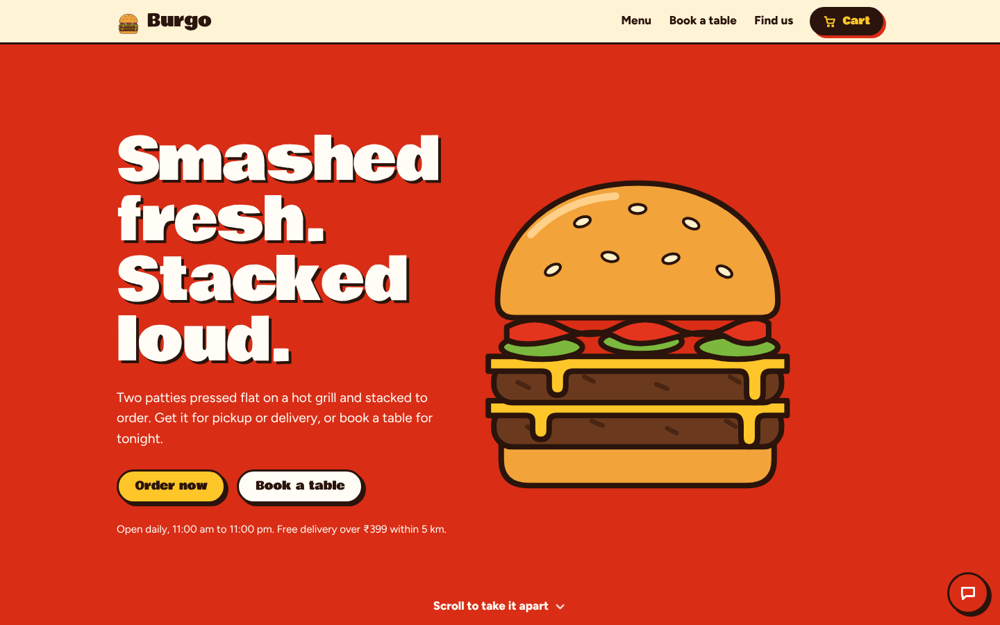
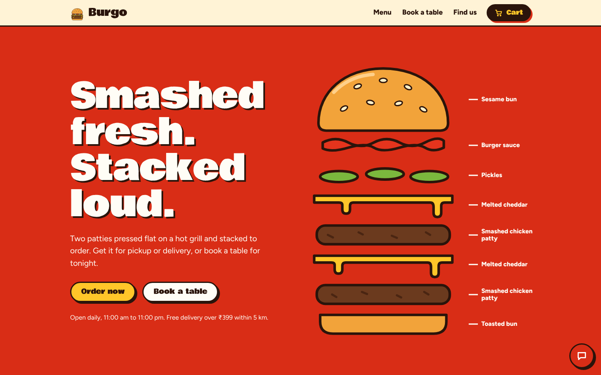
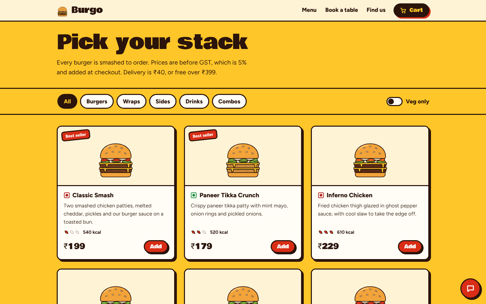
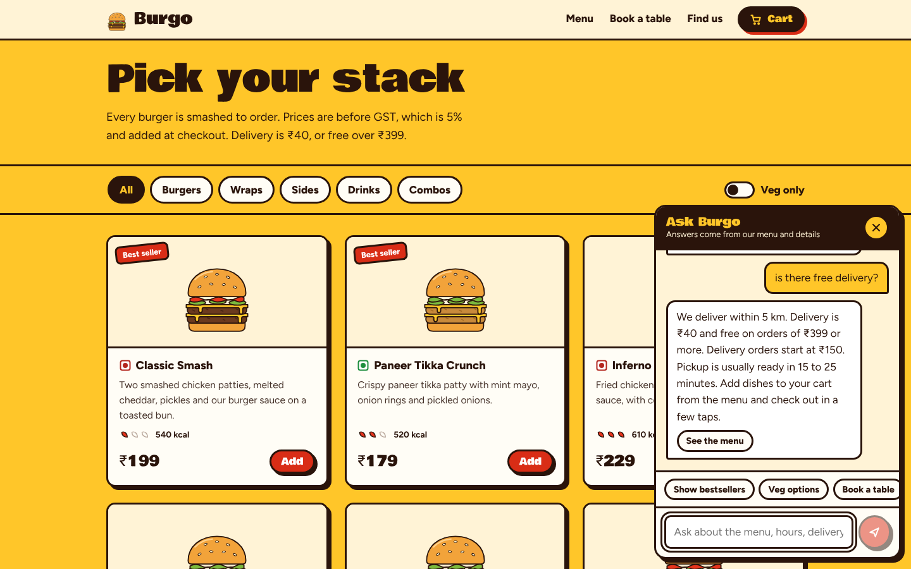

# Burgo: restaurant ordering, table booking and AI chat assistant

A sample fast-food restaurant ("Burgo Smash Kitchen") with a Java backend for the business rules and a Next.js
frontend with scroll animations. All the data (menu, prices, address) is made up and loads automatically.

**Live demo:** https://burgo-restaurant-ai-assistant.vercel.app

- **Backend:** Spring Boot 3.5, Java 21, JPA, in-memory H2 by default, PostgreSQL for deployment.
- **Frontend:** Next.js 16, React 19, TypeScript, Motion for animation.
- **What it does:** menu with filters, cart and ordering (pickup or delivery), table reservations with live
  seat counts, and a chat assistant that answers only from the restaurant's own data.



## Screenshots

**Scroll-driven hero.** The burger pulls apart layer by layer as you scroll.



**Menu with filters.** Category chips, a veg-only switch, spice levels and a cart.



**Chat assistant.** Answers from the menu and FAQ, and hands off to staff when it isn't sure.



## Run it locally

You need Java 21, Maven, and Node 20 or newer. Use two terminals.

```bash
# Terminal 1: backend on http://localhost:8080
cd backend
mvn spring-boot:run

# Terminal 2: frontend on http://localhost:3000
cd frontend
cp .env.example .env.local
npm install
npm run dev
```

Open http://localhost:3000. If the backend isn't running, the site shows a "kitchen is closed" page with the
command to start it.

Run the backend tests with `cd backend && mvn test`.

### Optional: turn on the Gemini fallback

The chat assistant works without any key. To let it handle questions the built-in rules can't answer, create an
API key in Google AI Studio and give it to the **backend** as an environment variable:

```bash
GEMINI_API_KEY=your_key mvn spring-boot:run
```

In IntelliJ, put `GEMINI_API_KEY=your_key` in the run configuration's **Environment variables** field. On start
the backend logs `Gemini fallback ENABLED` or `disabled`, so you can see whether the key was picked up. Never
put the key in the frontend or commit it. The model name is the setting `burgo.gemini.model` in
`backend/src/main/resources/application.yml`; Google retires model names from time to time, so change it there if
requests start failing with a 404.

## How it fits together

```
browser ──► Next.js (:3000) ──/api/* rewrite──► Spring Boot (:8080) ──► H2 / PostgreSQL
                                                      │
                                                      └─► Gemini API (optional fallback)
```

The browser only talks to the Next.js site. `next.config.ts` forwards `/api/*` to the backend, so there is no
CORS setup and the backend address stays on the server.

```
backend/src/main/java/com/burgo/api/
  core/      Business rules in plain Java, no framework: ReservationRules, OrderPricing, ChatEngine
  domain/    JPA entities: Restaurant, MenuItem, Reservation, CustomerOrder, OrderLine
  repo/      Spring Data repositories
  service/   Menu, reservation, order and chat services, plus the optional Gemini client
  web/       REST controller, request and response shapes (Dto), error handling
  config/    CORS, the clock, and the sample-data seeder

frontend/src/
  app/         layout, page, global styles
  components/  Hero (scroll animation), Menu, Reserve, CartDrawer, Chat, and the SVG food art
  lib/         API client, cart state, formatting helpers
```

## API

Every route is under `/api/r/{slug}`, and the sample restaurant's slug is `burgo`.

| Method | Path | What it does |
| --- | --- | --- |
| GET | `/menu` | Restaurant details and available menu items |
| GET | `/reservations/slots?date=YYYY-MM-DD` | Every time slot of the day with seats left |
| POST | `/reservations` | Book a table (1 to 12 guests, 30 minutes' notice, up to 30 days ahead) |
| POST | `/orders` | Place a pickup or delivery order |
| GET | `/orders/{reference}` | Look an order up by its reference, like `ORD-7K3M9Q` |
| POST | `/chat` | Ask the assistant a question |

Errors always look like `{ "message": "...", "fieldErrors": { "name": "..." } }`, and the message is written for
the customer.

## How the chat assistant works

1. **Rules first.** Intent rules handle greetings, opening hours, delivery, payment, reservations, order
   status, allergy questions and menu filters (veg, non-veg, spicy, cheapest, by category, by name).
2. **Search.** Anything else is matched against the menu and FAQ text with BM25 keyword scoring.
3. **Gemini fallback (optional).** If nothing matches well and `GEMINI_API_KEY` is set, the best matching menu and
   FAQ facts are sent to Gemini with instructions to answer only from them.
4. **Human handoff.** If there is still no good answer, it gives the restaurant's phone number instead of guessing.

This is keyword retrieval, not embeddings. Vector search over an uploaded menu is listed under next steps.

## Decisions worth knowing

- **Prices are never trusted from the browser.** An order carries item ids and quantities only. The server reads
  prices from the database and works out GST (5%), delivery fee and total in whole rupees.
- **Bookings can't be oversold.** Creating a reservation takes a row lock on the restaurant, so two people booking
  the last seats at the same moment are handled one after the other.
- **The assistant never guesses.** For allergy, vegan, jain or halal questions it says it can't confirm and
  points to the staff. The Gemini prompt forbids those claims too.
- **The LLM is optional.** If the key is missing or the Gemini call fails, the assistant falls back to the
  built-in answer and the site keeps working.
- **Multi-tenant ready.** Every menu item, booking and order belongs to a `restaurant_id`, and routes take the
  restaurant slug. A second restaurant is another row and another `NEXT_PUBLIC_RESTAURANT_SLUG`.
- **Motion respects the user.** With "reduce motion" turned on, the hero does not pin or animate, the ticker
  stops, and the word band stays still.

## Deploy

Vercel hosts only the frontend, so the backend and database go elsewhere. One setup that works:

| Part | Service | Notes |
| --- | --- | --- |
| Database | Supabase (PostgreSQL) | Use the **Session pooler** connection details |
| Backend | Railway | Root directory `backend`, built from `backend/Dockerfile` |
| Frontend | Vercel | Root directory `frontend` |

**Backend variables (Railway)**

| Variable | Value |
| --- | --- |
| `DB_URL` | `jdbc:postgresql://<pooler-host>:5432/postgres?sslmode=require` |
| `DB_USER` | `postgres.<project-ref>` |
| `DB_PASSWORD` | your database password |
| `GEMINI_API_KEY` | optional |
| `SPRING_DATASOURCE_HIKARI_MAXIMUM_POOL_SIZE` | `5` |
| `BURGO_CORS_ALLOWED_ORIGINS` | `https://<your-vercel-domain>` (comma-separated if more than one) |

`BURGO_CORS_ALLOWED_ORIGINS` is required. Browsers send an `Origin` header on POST requests (chat, orders,
bookings), and the backend rejects origins that aren't listed. Without it the menu loads but chat, ordering and
booking fail with a generic "something went wrong".

The Dockerfile pulls its base images from the AWS public mirror of Docker Hub, because shared build servers can
hit Docker Hub's rate limit. It starts the app with the `postgres` profile. Tables are created automatically and the sample
restaurant is seeded on first start. Check `https://<backend-domain>/api/r/burgo/menu` returns JSON.

**Frontend variables (Vercel)**

| Variable | Value |
| --- | --- |
| `API_URL` | `https://<backend-domain>` (no trailing slash) |
| `NEXT_PUBLIC_RESTAURANT_SLUG` | `burgo` |

Set `API_URL` before the first deploy, because `next.config.ts` reads it at build time; redeploy after changing it.

### Local PostgreSQL

```bash
createdb burgo
cd backend
mvn spring-boot:run -Dspring-boot.run.profiles=postgres
# override with DB_URL, DB_USER, DB_PASSWORD if needed
```

## What was checked

- The business rules and chat assistant are covered by unit tests (`ReservationRulesTest`, `OrderPricingTest`,
  `ChatEngineTest`).
- The frontend type-checks and builds, and was exercised in a browser against a stand-in API (filters, cart,
  ordering, booking, chat, keyboard handling, reduced motion, phone and desktop layouts).
- The full backend has been started locally with the in-memory database, and the chat assistant answers through
  the Gemini fallback when a valid key is set.
- `BurgoApiTests` (MockMvc end-to-end) should be run with `mvn test` on your machine.

## Where to take it next

1. An owner login and dashboard to edit the menu and see orders and bookings.
2. Upload a menu PDF and answer from it with pgvector retrieval instead of keyword search.
3. A WhatsApp channel for the same assistant and booking flow.
4. Online payments, then email or WhatsApp confirmations.
5. Synonyms in the chat rules ("dessert", "sweet") and understanding negations ("not spicy").
